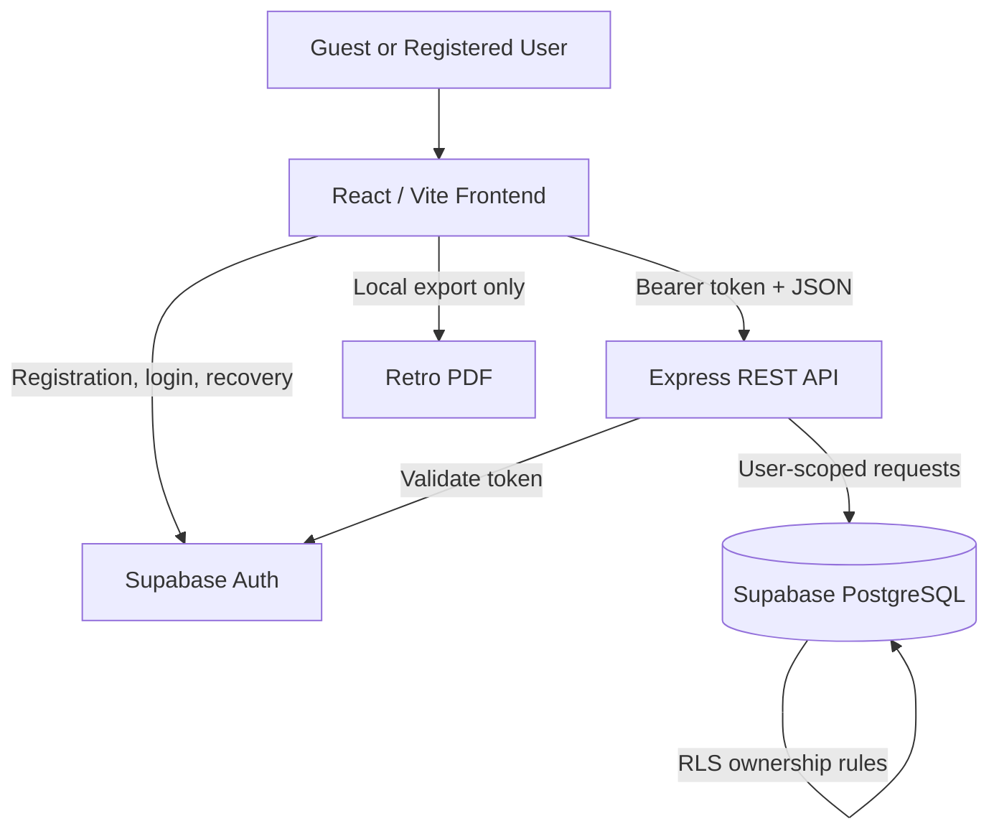

# RPG Character Creator — System Architecture

**Status:** Planned architecture and implementation contract, not a claim that all integrations exist.
**Working title:** RPG Character Creator.
**Linked specs:** [Requirements](./requirements.md), [Catalog](./customization-catalog.md), [Product Experience](./product-experience.md).

## 1. System Context

This full-stack application is a retro-themed creator for **one fictional RPG character per registered account**. It does not contain gameplay. The frontend and API are intentionally separate so the project demonstrates authentic client/server boundaries.



## 2. Technology Stack

| Responsibility | Technology |
|---|---|
| Frontend | React + TypeScript + Vite + CSS |
| Backend | Node.js + Express 5 + TypeScript |
| Authentication | Supabase Auth (email/password) |
| Database | Supabase PostgreSQL with Row Level Security |
| Testing | Vitest, Supertest, integration/ownership checks |
| CI/CD | GitHub Actions |
| Deployment | Vercel frontend; API deployment mode validated before release |
| Development | Google Cloud Shell Editor, Git/GitHub |

## 3. User and Navigation Flows

1. **Public entry:** Welcome page shows original minimalist RPG art, email/password sign-in, registration, and password recovery.
2. **Registration:** Display name, email, password, and password confirmation. Supabase Auth creates an account and sends an email-confirmation link.
3. **Session:** The app resolves user state after a confirmed sign-in. An authenticated account with no character enters the four-stage creator; an account with an existing character enters My Character.
4. **Character creation:** Class & Name → Origins → Equipment → Essence & Review → explicit Save.
5. **Returning user:** My Character displays the single saved record with Edit, Export PDF, Delete Character, Sign Out, and Account Settings.
6. **Reset:** Forgot Password displays generic feedback, uses a provider-managed recovery link, and leads to a secure password-reset screen.
7. **Export:** The browser creates a PDF locally from the authorized character record; the server does not store PDF files.

**Google OAuth is deferred.** No gender/sex field is collected for characters.

## 4. Frontend Responsibilities

- Maintain guest/authenticated/loading states and route guards.
- Render accessible registration, sign-in, verification, and recovery forms using Supabase Auth.
- Keep an editable character draft through grouped steps; preserve entered data on Back/Next.
- Render an ensemble of eight original class sprites before class selection and one original pair illustration for the chosen class.
- Load the class/attribute catalog by stable slug and label; show concise descriptions and selection feedback.
- Randomize only the draft, not the database or account profile.
- Use explicit actions to Save, Discard Edits, Delete Character, and Export PDF.
- Render the private My Character screen, responsive themes, validation errors and loading/empty/error states.
- Generate the retro PDF locally and keep it free of personally identifying account details.
- Never trust client-side route guards as the only authorization control.

## 5. API Responsibilities and Contracts

Base path: `/api`. The existing Express API already implements `GET /api/health`; all new character operations are planned.

| Method | Path | Auth | Response |
|---|---|---|---|
| GET | `/api/health` | Public | `200` service status |
| GET | `/api/characters/me` | Required | `200` own character or `404` if none |
| PUT | `/api/characters/me` | Required | `201` on creation, `200` on update |
| DELETE | `/api/characters/me` | Required | `204` after own character removed |

Request: `Authorization: Bearer <access_token>`.

`PUT /api/characters/me` takes exactly the editable character fields:

```json
{
  "name": "Eldrin",
  "characterClass": "mage",
  "ancestry": "elf",
  "background": "scholar",
  "weapon": "staff",
  "artifact": "moon-crystal",
  "personality": "curious",
  "aura": "arcane",
  "companion": "owl"
}
```

The caller cannot submit or overwrite `user_id`, `id`, `created_at`, or `updated_at`. The API derives owner ID from the **verified authenticated token** and uses database constraints to avoid duplicates. Allowed slugs and character name constraints are independently checked on the server.

Response conventions:

- `400` malformed or invalid input.
- `401` missing, invalid, or expired authentication.
- `403` forbidden operation when relevant.
- `404` no character on GET.
- `409` only where an explicit unique/conflict operation warrants it.
- `429` rate-limited request.
- `500` generic unexpected server error, without internal stack traces, secrets, or connection details.

## 6. Authentication Design

Supabase Auth owns password hashing, email confirmation, sign-in, sign-out, access/refresh token lifecycle, and password reset. The application **must not** maintain its own password table or password-reset tokens.

- Use a user-friendly `display_name` stored in authenticated-user metadata (or an RLS-protected profile table if future needs justify it).
- Require verified email before a new user can manage characters.
- Authentication errors must not distinguish an unknown account from an incorrect password.
- Password-recovery requests must return the same visible message for existing/non-existing accounts.
- Configure redirect allowlists, provider email templates, abuse/rate limits, and **custom production SMTP** before inviting the public.
- API middleware validates access tokens through provider-supported verification, not unverified JWT decoding.
- When using a Supabase client for API data operations, propagate the **end-user's** identity to database requests so RLS applies; do not use a privileged service-role client for routine character CRUD.

Reference: [Supabase Password Auth](https://supabase.com/docs/guides/auth/passwords), [OWASP Authentication](https://cheatsheetseries.owasp.org/cheatsheets/Authentication_Cheat_Sheet.html), [OWASP Forgot Password](https://cheatsheetseries.owasp.org/cheatsheets/Forgot_Password_Cheat_Sheet.html).

## 7. Storage and Business Rules

### Supabase-managed users

`auth.users` is managed by Supabase. The app references its UUID to identify the owner and never stores user passwords. The display name is an account property, not part of the fictional character.

### Application table: characters

| Column | Database type | Notes |
|---|---|---|
| `id` | UUID | Primary key, server-generated |
| `user_id` | UUID | Not null, unique, references `auth.users(id)` |
| `name` | VARCHAR(32) | Trimmed fictional name, 2–32 chars |
| `character_class` | TEXT | One of 8 class slugs |
| `ancestry` | TEXT | Valid catalog slug |
| `background` | TEXT | Valid catalog slug |
| `weapon` | TEXT | Valid catalog slug |
| `artifact` | TEXT | Catalog slug, including `none` |
| `personality` | TEXT | Valid catalog slug |
| `aura` | TEXT | Valid catalog slug |
| `companion` | TEXT | Catalog slug, including `none` |
| `created_at` | TIMESTAMPTZ | Database-generated |
| `updated_at` | TIMESTAMPTZ | Updated on write |

- `UNIQUE(user_id)` enforces at most one character per account.
- `ON DELETE CASCADE` for the auth user FK ensures account deletion also removes the character.
- Constrain fields using tested validation and versioned database checks or equivalent restrictions.
- No `gender_identity`, sex, avatar gender, or class-art asset selection column.
- Class images are static frontend assets and determined by `character_class`.
- No local PDF copies are persisted on the backend.
- Database SQL and RLS are committed as reviewed migrations.

See [Data Model](./uml/data-model.md) and [Customization Catalog](./customization-catalog.md).

## 8. Security Architecture

### 8.1 Identity and access

- Authenticate every protected API request; fail closed.
- Derive the user UUID from the verified session. Never accept client-provided ownership as an access decision.
- Enable RLS on every exposed application data table. Create explicit SELECT, INSERT, UPDATE, and DELETE policies scoped to `auth.uid() = user_id`.
- Require `WITH CHECK` for INSERT and UPDATE; confirm the API's DB access context actually exercises RLS.
- Verify uniqueness and ownership with direct integration tests for two distinct test accounts.

### 8.2 Input and output

- Validate JSON object shape and each enum string; reject unknown or oversized keys/fields.
- Enforce character name length/normalization in API and database; encode all user-provided text in rendered HTML and PDF.
- Avoid untrusted HTML injection and avoid reflecting exceptions to clients.
- Use schema validation at API boundaries; enforce reasonable body-size limits.

### 8.3 Credentials and browser

- Only public Supabase URL/publishable values are allowed in Vite's public environment. Never commit or expose `service_role`, SMTP credentials, database passwords, or other backend secrets.
- Use managed environment secrets, HTTPS, a restricted CORS origin allowlist, and suitable security headers.
- Follow Supabase's recommended token/session handling; do not write tokens to logs or URLs.
- Limit automated abuse on authentication and public endpoints. Do not use a custom homegrown account lockout or recovery mechanism.
- Ensure exported PDFs do not accidentally contain login email, display name, or token values.

### 8.4 Operational security and privacy

- Keep dependencies updated; review npm audit results and GitHub alerts.
- Log useful error/security events without passwords, tokens, private profile data, or entire request bodies.
- Document privacy notice, user data access/correction/deletion procedures, and error reporting before public launch.
- Perform a security acceptance review; no application can promise perfect security.

Reference: [Supabase RLS](https://supabase.com/docs/guides/database/postgres/row-level-security) and [Production Checklist](https://supabase.com/docs/guides/deployment/going-into-prod).

## 9. State Management and UX

- React holds auth/session state, character data, an editable draft, current wizard stage, save status, and theme.
- Draft changes do not affect persistence until explicit Save.
- Back/Next never discard valid selections; randomization only updates the draft.
- Prefer accessible text controls for selection, with decorative icons and class illustrations.
- Theme preference can be local to the browser; personal character fields are persisted in PostgreSQL.
- Keep `My Character` private and prevent flashing stale data from a previous session after sign-out.

## 10. Testing Strategy

| Test level | Required checks |
|---|---|
| Existing API smoke | Health returns 200; unknown routes return 404 |
| Schema and validation | Invalid class, malformed/oversized name, missing/invalid enum fields rejected |
| Auth | No token, invalid token, expired token rejected; email confirmation/recovery work |
| Authorization | User A cannot GET/PUT/DELETE User B's record; RLS verified independently |
| Persistence | Single-row invariant, save/update/reload/delete, duplicate-save handling |
| UX | Wizard Back/Next retains state, randomization does not auto-save |
| Export | PDF contains fictional attributes and no account email/token |
| CI | Frontend and API install/build/lint/test, secrets review, dependency advisories |

## 11. Deployment and Development

- Development currently runs in **Google Cloud Shell Editor**. Local scripts remain in the `web/` and `api/` directories.
- Deploy frontend from `web/` to Vercel with environment-specific **public** configuration.
- Deploy the Express API to a compatible Node runtime (Vercel function configuration or a dedicated service, decided during deployment implementation). Do not assume an ordinary long-running `server.listen` process works as-is in a serverless function.
- Supabase hosts Auth and PostgreSQL. Configure separate local/test/production credentials and production email delivery.
- GitHub Actions checks pull requests before merging to `main`.
- Add secrets only in deployment and GitHub secret management, never in code.
- Validate auth callback URLs, CORS origins, API URL, cookies/token behavior, email delivery, and RLS on the real deployed domains.

## 12. Architectural Decisions

- **AD-01:** Separate React UI and Express API to preserve a clear backend boundary.
- **AD-02:** Managed Supabase email/password Auth; Google OAuth deferred.
- **AD-03:** `UNIQUE(user_id)` and RLS for one private character per account.
- **AD-04:** Expanded data-driven customization catalog with seven enumerated choices, eight classes, and no gender/sex field.
- **AD-05:** Four grouped wizard stages, static pixel art, optional random draft generation, and no combat mechanics.
- **AD-06:** Local PDF export; no server-generated PDF storage.
- **AD-07:** Security verification and production email readiness before public signup.

## 13. Documentation Index

- [Project Overview](./project-overview.md)
- [Requirements](./requirements.md)
- [Customization Catalog](./customization-catalog.md)
- [Product Experience](./product-experience.md)
- [Data Model](./uml/data-model.md)
- [Use Cases](./uml/use-cases.puml)
- [Save Character Sequence](./uml/save-character-sequence.puml)
