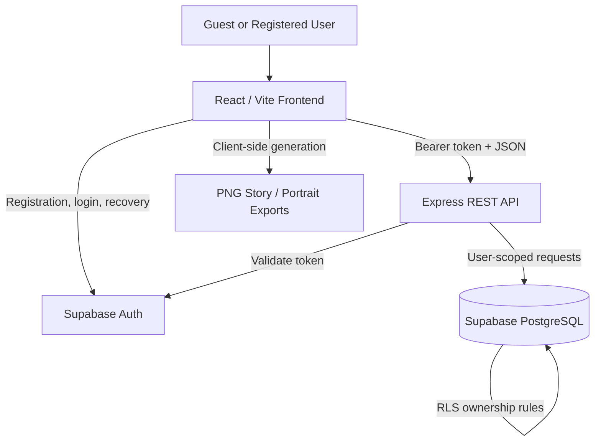

# Adventure Files — System Architecture

- **Status:** Feature-complete release candidate merged into `main` (latest `0a0457d`). The owner reports successful hosted authentication, CAPTCHA, account deletion/re-registration, cross-account isolation and desktop/mobile QA. Final hosted security/header and Supabase Free recoverability sign-off remains in Issue #24.
- **Product name:** Adventure Files
- **Linked specs:** [Requirements](./requirements.md), [Catalog](./customization-catalog.md), [Product Experience](./product-experience.md).

## 1. System Context

Adventure Files is a retro-themed full-stack application for creating and managing **at most one fictional RPG character per registered account**.

It is not a playable RPG.

The frontend and API are separate so the project demonstrates authentic client/server boundaries, authentication, authorization, persistence, and data validation.



The frontend owns the interactive character creation experience and export presentation.

The API owns authenticated character operations and server-side validation.

PostgreSQL owns persistent character records, database constraints, and Row Level Security.

## 2. Technology Stack

| Responsibility | Technology |
|---|---|
| Frontend | React + TypeScript + Vite + CSS |
| Backend | Node.js + Express 5 + TypeScript |
| Authentication | Supabase Auth (email/password) |
| Database | Supabase PostgreSQL with Row Level Security |
| Frontend testing | Vitest + React Testing Library |
| API testing | Vitest + Supertest + integration/ownership checks |
| Version control | Git + GitHub |
| CI/CD | GitHub Actions |
| Deployment | Vercel Hobby frontend with `/api` proxy to Render Free API; current hosted smoke/migration checks passed; zero-budget single-environment public demo proposed, safety review pending |
| Development | GitHub Codespaces (browser-based); Cloud Shell optional |

PNG exports are generated client-side from the authorized saved character using browser canvas/image APIs. PNG output dimensions and fields have automated tests; browser and device compatibility remain part of release verification.

## 3. User and Navigation Flows

1. **Public entry:** The Adventure Files start screen displays the title, original responsive pixel-art illustration, and blinking "PRESS START" prompt. A retro iris transition reveals authentication.
2. **Registration:** The user provides an email, password, and password confirmation. Supabase Auth manages account creation and email verification.
3. **Session:** The application resolves authentication state. An account without a saved character can enter the creator; an account with a saved character enters My Character.
4. **Character creation:** Identity → Origins → Equipment → Essence → Journey → Final Review.
5. **Explicit save:** The sixth stage displays the complete draft and saves only after user confirmation.
6. **Returning user:** My Character displays the saved character with editing, deletion, export, and sign-out actions.
7. **Password recovery:** The application uses Supabase Auth's managed recovery flow and safe feedback.
8. **Export:** The browser generates the selected PNG file locally from the authorized saved character record.

### 3.1. Approved Six-Stage Creator

| Stage | Name | Fields |
|---|---|---|
| 01 / 06 | Identity | Class and character name |
| 02 / 06 | Origins | Ancestry and background |
| 03 / 06 | Equipment | Weapon and artifact |
| 04 / 06 | Essence | Personality and aura |
| 05 / 06 | Journey | Companion and motivation |
| 06 / 06 | Final Review | Review and explicit save |

The first five stages contain two fields each.

The sixth stage contains no new customization fields.

All required selections must be valid before saving.

The frontend must preserve the character draft when navigating between stages.

### 3.2. Approved Export Formats

| Format | Dimensions | Purpose |
|---|---|---|
| PNG Story/Status | 1080 × 1920 | Instagram Stories and WhatsApp Status |
| PNG Portrait | 1080 × 1350 | Portrait social posts and sharing |

The November 1, 2026 scope decision excludes PDF export.

The application provides file downloads.

Direct social-media publishing is outside the initial scope.

Google OAuth remains deferred.

No sex or gender field is collected for fictional characters.

## 4. Frontend Responsibilities

The React application must:

- Maintain guest, authenticated, loading, and error states.
- Protect authenticated frontend views.
- Render the approved dark retro visual identity.
- Support Portuguese and English interface labels.
- Preserve language-independent catalog identifiers.
- Render the Adventure Files start screen with separate desktop and mobile artwork.
- Provide the approved "PRESS START" and iris-transition interactions.
- Render the authenticated My Character area.
- Support the complete six-stage creator.
- Preserve draft selections during Back/Continue navigation.
- Preserve the draft during language changes and recoverable failures.
- Render the eight-class ensemble before class selection.
- Display the corresponding class illustration after explicit selection.
- Keep hover and keyboard focus separate from confirmed selection.
- Validate the current stage before continuing.
- Display all character values in Final Review.
- Require an explicit Save action.
- Prevent duplicate save submissions.
- Display safe loading, validation, success, and error feedback.
- Load saved character values before editing.
- Support character deletion with explicit confirmation.
- Generate and download both approved PNG exports.
- Keep authentication credentials and private account information out of exports.

Client-side validation improves usability but does not replace API validation.

Frontend route guards are not the final authorization boundary.

### 4.1. Character Draft

The draft represents the character currently being created or edited.

Its target structure contains:

- Name.
- Class.
- Ancestry.
- Background.
- Weapon.
- Artifact.
- Personality.
- Aura.
- Companion.
- Motivation.

The draft may contain incomplete selections while the user navigates through the creator.

The saved character must satisfy the complete validation rules.

When editing, initial draft values come from the saved record.

Canceling an edit does not persist the draft.

### 4.2. Responsive Creator Layout

The first stage retains the approved class artwork and form arrangement.

Stages 02–05 contain two customization groups each.

On desktop:

- Paired groups appear side by side.
- Option buttons use consistent dimensions.
- A short, subtle divider separates the option grids.
- The divider does not extend through category headings or navigation buttons.

On mobile:

- Paired groups stack vertically.
- Desktop divider lines are removed.
- Existing approved mobile spacing and interaction patterns are preserved.

The creator header displays progress on the left and PT/EN on the right.

## 5. API Responsibilities and Contracts

Base path: `/api`.

The Express API implements the health endpoint, authenticated character GET/PUT/DELETE routes, and a separate self-service account-deletion route. The latter requires the trusted API's Supabase administrator credential and fresh password verification.

The six-stage character payload and revised catalog are implemented on `main`. Hosted migration/RLS checks and owner-reported cross-account isolation have passed; final production configuration and backup sign-off remain tracked in Issue #24.

| Method | Path | Auth | Response |
|---|---|---|---|
| GET | `/api/health` | Public | `200` service status |
| GET | `/api/characters/me` | Required | `200` own character or `404` if none |
| PUT | `/api/characters/me` | Required | `201` on creation, `200` on update |
| DELETE | `/api/characters/me` | Required | `204` after own character removed |
| DELETE | `/api/account/me` | Required + fresh password | `204` after Auth account and cascaded character deletion |

Protected requests use:

`Authorization: Bearer <access_token>`

### 5.1. Character Payload

`PUT /api/characters/me` accepts the complete editable character data:

```json
{
  "name": "Eldrin",
  "characterClass": "mage",
  "ancestry": "elf",
  "background": "scholar",
  "weapon": "staff",
  "artifact": "arcane-seal",
  "personality": "curious",
  "aura": "arcane",
  "companion": "dragon",
  "motivation": "knowledge"
}
```

The API validates the new Motivation field with the revised catalog. Validate compatibility against live deployment configurations before release.

The caller cannot submit or overwrite:

- `user_id`
- `id`
- `created_at`
- `updated_at`

The API derives ownership from the verified authenticated token.

Character fields must be independently validated on the server.

### 5.2. Catalog Validation

The server must validate:

| Field | Rule |
|---|---|
| `name` | Required, trimmed, 2–32 characters |
| `characterClass` | One of 8 approved classes |
| `ancestry` | One of 6 approved values |
| `background` | One of 6 approved values |
| `weapon` | One of 8 approved values |
| `artifact` | One of 8 approved values; `none` prohibited |
| `personality` | One of 8 approved values |
| `aura` | One of 8 approved values |
| `companion` | One of 8 approved values; `none` permitted |
| `motivation` | One of 8 approved values |

Motivation is required in the current character model.

The canonical identifiers are documented in [Customization Catalog](./customization-catalog.md).

Translated display labels must never replace stored catalog identifiers.

### 5.3. Response Conventions

- `400` — Malformed or invalid input.
- `401` — Missing, invalid, or expired authentication.
- `403` — Forbidden operation when relevant.
- `404` — No character found on GET.
- `409` — Explicit uniqueness or conflict operation where applicable.
- `429` — Rate-limited request.
- `500` — Generic unexpected server error.

Server errors must not expose stack traces, credentials, connection details, or other sensitive information.

### 5.4. Character Ownership and Uniqueness

The API must:

- Validate every protected request.
- Derive the user identifier from the authenticated session.
- Read and modify only the authenticated user's record.
- Preserve the one-character-per-account constraint.
- Reject invalid catalog values.
- Avoid duplicate records during repeated submissions.
- Return safe and consistent errors.

The database remains responsible for enforcing uniqueness and ownership constraints.

## 6. Authentication Design

Supabase Auth owns:

- Password hashing.
- Email confirmation.
- Sign-in and sign-out.
- Access and refresh token lifecycle.
- Password recovery.

The application must not maintain a custom password table or password-reset tokens.

Authentication requirements:

- Collect only the email and password credentials needed for signup; no account display name is required.
- Require verified email before new users can manage characters when confirmation is configured.
- Avoid revealing whether an account exists through authentication or recovery messages.
- Configure redirect allowlists and provider email templates.
- Configure suitable authentication abuse protections.
- Prepare production email delivery before public registration.
- Validate access tokens using provider-supported verification.
- Avoid relying on unverified JWT decoding.
- Use end-user identity for ordinary database operations so RLS applies.

Privileged service-role access must not be used for routine character CRUD.

References:

- [Supabase Password Auth](https://supabase.com/docs/guides/auth/passwords)
- [OWASP Authentication](https://cheatsheetseries.owasp.org/cheatsheets/Authentication_Cheat_Sheet.html)
- [OWASP Forgot Password](https://cheatsheetseries.owasp.org/cheatsheets/Forgot_Password_Cheat_Sheet.html)

## 7. Storage and Business Rules

### 7.1. Supabase-Managed Users

`auth.users` is managed by Supabase.

The application references the authenticated user's UUID.

Passwords are never stored in application-owned tables.

No account display name is required. A character's fictional name is stored in its own protected character record.

### 7.2. Application Table: characters

The following table describes the **revised character schema** implemented through project migrations. Confirm that the target deployment has applied the required migrations and RLS policies before production release.

| Column | Database type | Notes |
|---|---|---|
| `id` | UUID | Primary key, server-generated |
| `user_id` | UUID | Not null, unique, references `auth.users(id)` |
| `name` | VARCHAR(32) | Trimmed fictional name, 2–32 characters |
| `character_class` | TEXT | One of 8 class slugs |
| `ancestry` | TEXT | One of 6 ancestry slugs |
| `background` | TEXT | One of 6 background slugs |
| `weapon` | TEXT | One of 8 weapon slugs |
| `artifact` | TEXT | One of 8 artifact slugs; `none` excluded |
| `personality` | TEXT | One of 8 personality slugs |
| `aura` | TEXT | One of 8 aura slugs |
| `companion` | TEXT | One of 8 companion slugs, including `none` |
| `motivation` | TEXT | One of 8 motivation slugs; required for new records |
| `created_at` | TIMESTAMPTZ | Database-generated |
| `updated_at` | TIMESTAMPTZ | Updated on write |

### 7.3. Database Rules

- `UNIQUE(user_id)` enforces at most one character per account.
- The foreign key to `auth.users(id)` uses the approved account-deletion behavior.
- Character names must meet the approved length constraints.
- Enumerated fields must match the approved catalog.
- Only Companion supports the explicit value `none`.
- Motivation is required for new records; migrations and compatibility must be verified in each deployed environment.
- Class illustrations remain static frontend assets determined by `character_class`.
- No gender, sex, body-type, or class-art selection column is introduced.
- Generated PNG files are not persisted as character database columns.
- SQL changes and RLS policies must be maintained through reviewed migrations.

### 7.4. Catalog Identifier Changes

The approved catalog includes:

| Category | Previous identifier | New identifier |
|---|---|---|
| Artifact | `emerald-amulet` | `arcane-seal` |
| Companion | `dragonling` | `dragon` |

The artifact catalog also includes:

- `shadow-crown`
- `chaos-orb`

These identifiers must be coordinated across:

- Frontend types.
- Option translations.
- API validation.
- Database constraints.
- Automated tests.
- Existing saved-character compatibility.

### 7.5. Safe Migration Strategy

The updated character model introduces new requirements that may be incompatible with previously saved records.

Migration work must begin with an inspection of the actual database schema and existing data.

The implementation must:

1. Identify currently deployed character columns and constraints.
2. Check whether existing records contain older catalog values.
3. Add support for `motivation` without invalidating existing records during the transition.
4. Define how older artifact and companion identifiers will remain readable or be migrated.
5. Avoid assigning arbitrary motivations to existing characters.
6. Validate the application and API against transitional data.
7. Apply stricter constraints only after compatibility is established.
8. Verify read, create, edit, and delete operations after migration.

An initial nullable `motivation` column may be appropriate during a compatibility transition.

The final model requires Motivation for newly completed characters.

No existing character should be deleted or silently overwritten solely because the catalog changed.

The exact SQL migration must be reviewed before execution.

See:

- [Data Model](./uml/data-model.md)
- [Customization Catalog](./customization-catalog.md)

## 8. Security Architecture

### 8.1. Identity and Access

- Authenticate every protected API request.
- Reject missing, invalid, or expired credentials.
- Derive ownership from the verified user session.
- Never accept a client-provided user ID as an authorization decision.
- Enable RLS on exposed application tables.
- Define SELECT, INSERT, UPDATE, and DELETE policies scoped to the authenticated user.
- Require appropriate `WITH CHECK` conditions for inserts and updates.
- Verify the API's database context actually enforces RLS.
- Test uniqueness and ownership with two separate accounts.

### 8.2. Input and Output

- Validate JSON object shapes and enumerated strings.
- Reject invalid and oversized fields.
- Validate names in both API and database layers.
- Render user-provided character names safely.
- Avoid untrusted HTML injection.
- Do not expose internal exceptions to API consumers.
- Enforce suitable request body-size limits.
- Update validation whenever the approved catalog changes.

### 8.3. Credentials and Browser

- Only public Supabase configuration values may be exposed through the frontend.
- Never expose service-role credentials or database passwords.
- Keep secrets out of Git history.
- Use HTTPS in production.
- Configure restrictive CORS policies.
- Apply suitable security headers.
- Follow recommended session and token handling.
- Never place authentication tokens in logs or exported files.
- Protect public endpoints against automated abuse.

### 8.4. Export Privacy

Every export format must exclude:

- Account passwords.
- Authentication tokens.
- Internal user identifiers.
- Authentication metadata.
- Unrelated account information.

Exports must use only the authorized saved character data and approved presentation assets.

The filename may include a sanitized character name, but must not include credentials or internal account identifiers.

### 8.5. Operational Security and Privacy

- Keep dependencies updated.
- Review dependency advisories and GitHub alerts.
- Log useful operational events without sensitive credentials.
- Document user data access, correction, and deletion procedures.
- Review authentication and authorization before public deployment.
- Verify production email and account-recovery behavior.
- Perform security acceptance testing before release.

References:

- [Supabase RLS](https://supabase.com/docs/guides/database/postgres/row-level-security)
- [Supabase Production Checklist](https://supabase.com/docs/guides/deployment/going-into-prod)

### 8.6. Irreversible Account Deletion

- The frontend displays a bilingual, pixel-styled deletion confirmation from the empty dashboard or the saved-character Delete menu, alongside a compact Extras/Credits panel. Existing character creation, editing and PNG exports are unchanged.
- The user must supply their current password and type an explicit confirmation. The API accepts only the verified Bearer-token identity; user IDs and email addresses in the request body cannot select another deletion target.
- The API reauthenticates the current verified email/password pair via Supabase Auth and compares the returned identity with the originally authenticated user ID.
- `SUPABASE_SECRET_KEY` is a privileged server-only variable in Render. Only the account-deletion route may use the admin client; ordinary character reads/writes keep their RLS-enforced user JWT client.
- Deleting the Auth user cascades to the saved character via the existing foreign key. A deleted Auth user cannot refresh sessions, but JWTs may remain valid until expiration; sensitive routes must not rely on a stale client-only session.
- Account deletion returns `204` only after the provider acknowledges success. All other paths fail closed, including wrong password, invalid session, missing server key or upstream error. Confirm with isolated test accounts before public registration.

## 9. State Management and UX

React holds:

- Authentication/session state.
- Saved character data.
- Editable character draft.
- Current creator stage.
- Validation state.
- Save status.
- Selected interface language.
- Export generation status.

Draft changes do not affect persistent records until explicit Save.

Back and Continue navigation preserve valid selections.

Changing language does not alter stored identifiers.

Optional randomization modifies only the draft.

The sixth stage is reserved for review and saving.

The frontend must avoid displaying stale character data after sign-out.

The application uses one fixed dark theme.

## 10. Testing Strategy

| Test level | Required checks |
|---|---|
| API smoke | Health returns 200; unknown routes return 404 |
| Schema and validation | Invalid names, missing Motivation, invalid artifact and companion slugs, malformed fields |
| Authentication | Missing, invalid, and expired credentials rejected |
| Authorization | User A cannot access User B's record; RLS independently verified |
| Persistence | Single-row invariant, create, update, reload, delete, duplicate-save handling |
| Creator UX | Six stages, required selections, progress indicator, draft preservation, Back/Continue behavior |
| Localization | PT/EN labels change without altering selected slugs or draft values |
| Class artwork | Eight-class default, explicit selection, persistent active state |
| Data migration | Existing records remain readable and safely editable during schema evolution |
| Story/Status export | Valid PNG at exactly 1080 × 1920 pixels |
| Portrait export | Valid PNG at exactly 1080 × 1350 pixels |
| CI | Frontend and API install, build, lint, tests, and configured security checks |

Passing frontend tests alone does not establish database or API compatibility.

The completed workflow must be validated through integration tests.

## 11. Deployment and Development

- **Current stack:** React/Vite frontend on the stable Vercel Hobby hostname `https://adventure-files-staging.vercel.app/`; `web/vercel.json` rewrites `/api/:path*` to `https://adventure-files-api-staging.onrender.com` (Render Free Express API). Authentication and PostgreSQL RLS run in Supabase Free. GitHub Actions checks builds, lint, tests and isolated database security.
- **November 3–4 evidence:** The developer confirmed Vercel/Render `/api/health` and unauthenticated `/api/characters/me`, hosted account-isolation checks, SPA `/reset-password`, SMTP OTP recovery and a successful Render redeploy with strict `CORS_ORIGIN`. Read-only hosted SQL confirmed both migrations, RLS, owner policies and no missing Motivation in two saved records.
- **Portfolio demo hosting decision:** The owner is using the existing **single zero-budget demo environment** at the stable URL rather than creating a second paid infrastructure stack. This is a deliberate cost/time trade-off, **not** separate production/staging isolation. The API resource may retain its `staging` hostname while serving the public demo; document that fact honestly.
- Before making that single environment public, confirm Vercel's stable domain, Supabase site/redirect allowlists, `VITE_AUTH_REDIRECT_ORIGIN`, Render CORS, HTTPS, appropriate security headers, email/rate limits, anti-abuse controls, data deletion guidance and log/error monitoring. Do not change database migrations or secrets without approval.
- **Free-tier risks:** Render may cold-start after inactivity; Supabase may pause low-activity projects; personal Gmail SMTP is not a high-volume transactional provider. No contractual uptime or guaranteed email delivery is claimed for the portfolio demo.
- Development remains in GitHub Codespaces with Cloud Shell as an alternative. Never commit credentials; use environment-specific public keys and server-side secret storage. Private repository visibility must not change until the full Git history is reviewed for secrets.
- If production isolation becomes necessary **after the portfolio release**, introduce it as a separately scoped improvement rather than delaying this frozen MVP.
- See [the release runbook](./free-portfolio-release.md) for launch gates, rollback expectations, SEO, privacy and issue/PR sequencing.

## 12. Architectural Decisions

- **AD-01:** Separate React frontend and Express API to preserve a clear backend boundary.
- **AD-02:** Use Supabase-managed email/password authentication; defer Google OAuth.
- **AD-03:** Enforce one private saved character per account using `UNIQUE(user_id)` and RLS.
- **AD-04:** Use a version-controlled catalog containing eight classes and eight enumerated customization categories, without sex or gender fields.
- **AD-05:** Use a six-stage guided creator with two fields in each of the first five stages and an exclusive Final Review stage.
- **AD-06:** Generate both approved PNG formats from saved character data without server-side file persistence.
- **AD-07:** Require security verification and production email readiness before public registration.
- **AD-08:** Preserve a fixed dark visual identity without a light/dark theme toggle.
- **AD-09:** Place the responsive Adventure Files start screen before authentication, with original artwork and a retro iris transition.
- **AD-10:** Support Portuguese and English labels while retaining stable English catalog identifiers.
- **AD-11:** Preserve the eight-class ensemble and explicit class-selection illustration behavior.
- **AD-12:** Keep desktop paired category layouts and mobile stacked layouts, using subtle desktop-only dividers.
- **AD-13:** Introduce the Motivation field and changed catalog identifiers through reviewed, compatibility-safe API and database updates.
- **AD-14:** Require explicit user confirmation before saving changes or deleting a character.
- **AD-15:** Use the saved character record as the common source for the My Character dashboard and all export formats.

## 13. Documentation Index

- [Project Overview](./project-overview.md)
- [Requirements](./requirements.md)
- [Customization Catalog](./customization-catalog.md)
- [Product Experience](./product-experience.md)
- [Data Model](./uml/data-model.md)
- [Use Cases](./uml/use-cases.puml)
- [Save Character Sequence](./uml/save-character-sequence.puml)