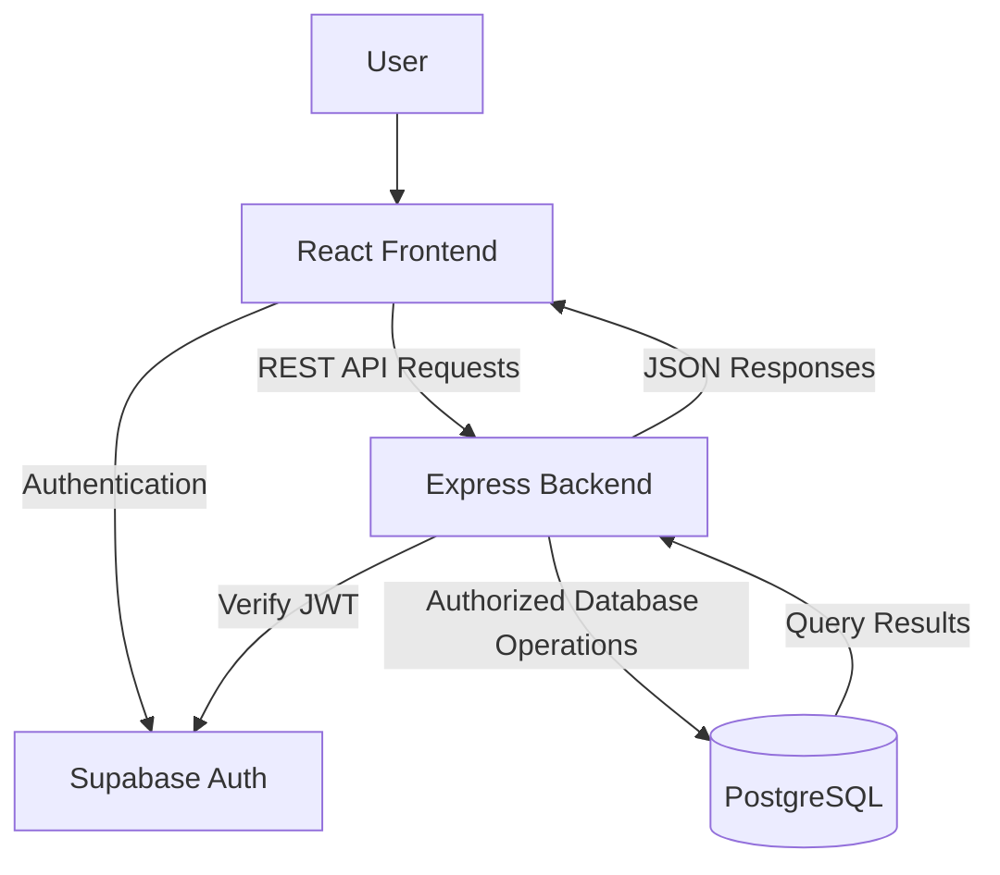

# RPG Character Creator — System Architecture

## 1. Overview

RPG Character Creator is a full-stack web application that allows
authenticated users to create and customize fictional RPG characters.

The application follows a simple client-server architecture with
separate frontend, backend, authentication, and database responsibilities.

The architecture prioritizes maintainability, security, and a small MVP scope.

## 2. Technology Stack

| Layer | Technology | Responsibility |
|---|---|---|
| Frontend | React, TypeScript, Vite | User interface and interactions |
| Backend | Node.js, Express, TypeScript | REST API and business logic |
| Authentication | Supabase Auth | User registration and authentication |
| Database | PostgreSQL (Supabase) | Persistent character storage |
| Version Control | GitHub | Source code and collaboration |
| CI/CD | GitHub Actions | Automated validation |
| Deployment | Vercel | Frontend and backend hosting |

## 3. High-Level Architecture

### 3.1 Frontend Responsibilities

The frontend is responsible for:

- Displaying registration and login forms.
- Managing authentication state.
- Rendering character classes and customization options.
- Collecting and validating basic form input.
- Sending authenticated requests to the REST API.
- Displaying saved character data.
- Supporting light and dark themes.
- Providing responsive and accessible interfaces.

### 3.2 Backend Responsibilities

The backend is responsible for:

- Exposing REST API endpoints.
- Validating access tokens.
- Identifying the authenticated user.
- Validating character data and allowed values.
- Applying business rules.
- Reading and updating character records.
- Returning consistent JSON responses.
- Handling application errors.

### 3.3 Authentication Responsibilities

Supabase Auth manages:

- User registration.
- Email and password authentication.
- User sessions.
- Access tokens.
- Sign-out operations.

The frontend uses Supabase Auth for authentication.

Protected backend requests must include a valid access token.

### 3.4 Database Responsibilities

PostgreSQL stores:

- Character names.
- Character classes.
- Character customization choices.
- Character ownership information.
- Creation and update timestamps.

Authentication records are managed separately by Supabase Auth.

## 4. Authentication Flow

1. The user submits login credentials through the frontend.
2. Supabase Auth validates the credentials.
3. The frontend receives an authenticated session.
4. The frontend includes the access token in protected API requests.
5. The backend validates the token with Supabase Auth.
6. The backend identifies the authenticated user.
7. The backend processes authorized character operations.

The backend must never trust a user ID submitted by the client.

## 5. REST API Design

Base path:

`/api`

### Public Endpoints

| Method | Endpoint | Description |
|---|---|---|
| GET | `/api/health` | Check API availability |

### Protected Endpoints

| Method | Endpoint | Description |
|---|---|---|
| GET | `/api/characters/me` | Retrieve the authenticated user's character |
| PUT | `/api/characters/me` | Create or update the authenticated user's character |

### API Request Format

Protected requests use:

`Authorization: Bearer <access_token>`

Character data is exchanged using JSON.

### Response Behavior

- `200 OK`: Successful retrieval or update.
- `201 Created`: Character created successfully.
- `400 Bad Request`: Invalid request data.
- `401 Unauthorized`: Missing or invalid authentication.
- `404 Not Found`: Requested character does not exist.
- `500 Internal Server Error`: Unexpected server error.

## 6. Initial Data Model

### 6.1 User

Users are managed by Supabase Auth.

The application uses the authenticated user's unique identifier
to associate character records with their owners.

A separate application users table is not required for the MVP.

### 6.2 Character

| Field | Type | Description |
|---|---|---|
| id | UUID | Primary key |
| user_id | UUID | Unique owner identifier |
| name | VARCHAR(32) | Character name |
| character_class | TEXT | Selected character class |
| gender_identity | TEXT, nullable | Optional character gender identity |
| origin | TEXT | Selected origin |
| artifact | TEXT | Selected artifact |
| aura | TEXT | Selected aura |
| created_at | TIMESTAMPTZ | Creation timestamp |
| updated_at | TIMESTAMPTZ | Last update timestamp |

### Data Constraints

- Each character belongs to exactly one authenticated user.
- Each user can own only one character.
- `user_id` must be unique.
- Character names must contain between 2 and 32 characters.
- Character classes must match predefined allowed values.
- Origin, artifact, and aura must match predefined allowed values.
- Gender identity is optional.
- Character records must not be accessible to other users.

The exact values for origin, artifact, and aura will be finalized
before database implementation.

## 7. Security Architecture

### 7.1 Authentication

Protected requests require a valid Supabase access token.

The backend validates tokens through Supabase Auth before
executing protected operations.

### 7.2 Authorization

The backend derives character ownership from the verified
authenticated user.

Client-provided user identifiers must not be trusted.

### 7.3 Row Level Security

Row Level Security (RLS) must be enabled for the character table.

Policies must restrict SELECT, INSERT, and UPDATE operations
to records belonging to the authenticated user.

Database operations must preserve the authenticated user's
identity so RLS policies can be enforced.

### 7.4 Environment Variables

Sensitive configuration must not be committed to the repository.

Backend secrets must never be exposed through frontend
environment variables.

Example configuration files may be committed without real values.

### 7.5 Input Validation

The backend validates:

- Character name length.
- Character class.
- Gender identity.
- Origin.
- Artifact.
- Aura.

Invalid data must not be persisted.

## 8. Frontend State Management

The frontend manages:

- Authentication state.
- Character form state.
- API loading and error states.
- Current interface theme.

The selected light or dark theme may be stored locally
in the browser.

Character data must be persisted in PostgreSQL rather than
only in browser storage.

## 9. Deployment Architecture

The application will be hosted using Vercel.

The planned deployment includes:

- A frontend deployment for the React application.
- A backend deployment for the Express API.
- A Supabase project for authentication and PostgreSQL.

Deployment configuration and environment variables will be
implemented in a later development phase.

## 10. Testing Strategy

Automated tests will focus on:

- Character input validation.
- Authentication requirements.
- Unauthorized request rejection.
- Character creation and updates.
- Character ownership restrictions.
- Database persistence behavior.

GitHub Actions will run essential checks before production deployment.

## 11. Architectural Decisions

### AD-01 — Separate Frontend and Backend

React and Express will be organized in separate project directories.

Reason: Clear responsibilities and opportunities to demonstrate
frontend and backend engineering practices.

### AD-02 — Managed Authentication

Supabase Auth will manage user authentication.

Reason: Reduce authentication complexity while maintaining
a dedicated backend for business logic.

### AD-03 — One Character per User

Each authenticated user can create one character.

Reason: Keep the data model and application workflow simple.

### AD-04 — REST API

Character operations will use a REST API.

Reason: Provide a clear contract between the frontend and backend.

### AD-05 — Minimal Feature Scope

Gameplay, multiplayer features, and dynamic sprite generation
are excluded from the initial release.

Reason: Prioritize a functional, secure, and maintainable MVP.

## 12. Related Documentation

- [Project Overview](./project-overview.md)
- [System Requirements](./requirements.md)
- [Use Case Diagram](./uml/use-cases.puml)
- [Save Character Sequence](./uml/save-character-sequence.puml)
- [Data Model](./uml/data-model.md)