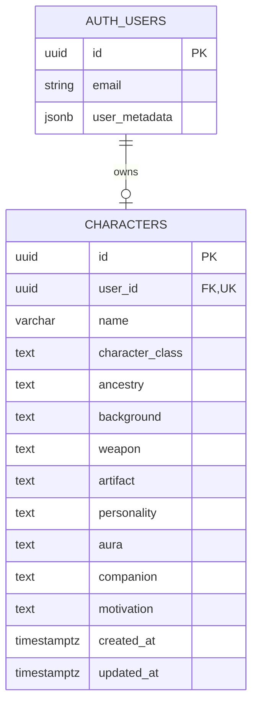

# Adventure Files — Data Model

- **Project:** Adventure Files
- **Document type:** Entity relationship and data persistence specification
- **Status:** Implemented on the feature branch; target Supabase deployment and legacy-data verification pending

## 1. Entity Relationship Diagram

The following diagram represents the approved target data model.

The feature branch includes the `motivation` field, updated validation and a version-controlled migration (`supabase/migrations/20261031000000_extend_characters_for_six_steps.sql`). Local tests have passed; this does not confirm that a hosted Supabase project has received the migration.



## 2. Source of Truth

### AUTH_USERS

The Supabase-managed `auth.users` table represents authenticated accounts.

Supabase Auth manages:

- Email addresses.
- Authentication credentials.
- Password verification.
- Email confirmation.
- Password recovery.
- Authentication sessions.

A minimal `display_name` may be stored in authenticated-user metadata.

Authentication credentials are not duplicated in application-owned character tables.

### CHARACTERS

The application-owned `public.characters` table stores fictional RPG character information.

Each character contains:

- Name.
- Class.
- Ancestry.
- Background.
- Weapon.
- Artifact.
- Personality.
- Aura.
- Companion.
- Motivation.

The character record does not store authentication credentials or unrelated personal information.

### Relationship

One authenticated user may own zero or one saved character.

Every saved character belongs to one existing authenticated user.

The `user_id` field:

- References `auth.users(id)`.
- Is not nullable.
- Has a UNIQUE constraint.
- Determines character ownership.

### Delete Behavior

The approved foreign-key relationship uses `ON DELETE CASCADE`.

Deleting an authentication account also removes its associated character record.

Deleting a character does not delete the authentication account.

## 3. Approved Target Constraints

The following constraints describe the intended final database model.

| Column | Rule |
|---|---|
| `id` | UUID primary key, server-generated |
| `user_id` | UUID, not null, unique, references `auth.users(id)` |
| `name` | Trimmed fictional character name, 2–32 characters |
| `character_class` | One of 8 approved class slugs |
| `ancestry` | One of 6 approved ancestry slugs |
| `background` | One of 6 approved background slugs |
| `weapon` | One of 8 approved weapon slugs |
| `artifact` | One of 8 approved artifact slugs; `none` prohibited |
| `personality` | One of 8 approved personality slugs |
| `aura` | One of 8 approved aura slugs |
| `companion` | One of 8 approved companion slugs, including `none` |
| `motivation` | One of 8 approved motivation slugs; required in the completed model |
| `created_at` | Database-managed timestamp |
| `updated_at` | Updated on successful write |

The [Customization Catalog](../customization-catalog.md) defines the authoritative identifiers.

Display labels may be translated into Portuguese and English without changing stored values.

The database and API must enforce compatible validation rules.

## 4. Approved Catalog Changes

The six-stage character creator introduces changes to the existing catalog.

### 4.1. Artifact

The artifact category contains eight approved options.

Every new character must select one artifact.

The identifier `none` is not permitted.

The approved catalog replaces:

| Previous identifier | New identifier |
|---|---|
| `emerald-amulet` | `arcane-seal` |

The new value represents:

- Portuguese: Selo Arcano.
- English: Arcane Seal.

Other previously approved artifact replacements include:

- `shadow-crown` — Shadow Crown / Coroa Sombria.
- `chaos-orb` — Chaos Orb / Orbe do Caos.

### 4.2. Companion

The companion category contains eight approved options.

Companion requires an explicit selection.

The identifier `none` remains valid and represents a character without a companion.

The approved catalog replaces:

| Previous identifier | New identifier |
|---|---|
| `dragonling` | `dragon` |

The new value represents:

- Portuguese: Dragão.
- English: Dragon.

### 4.3. Motivation

Motivation is a new customization category introduced in Step 05 — Journey.

The database field is named:

`motivation`

Its approved identifiers are:

| Identifier | English | Portuguese |
|---|---|---|
| `protection` | Protection | Proteção |
| `freedom` | Freedom | Liberdade |
| `justice` | Justice | Justiça |
| `redemption` | Redemption | Redenção |
| `glory` | Glory | Glória |
| `knowledge` | Knowledge | Conhecimento |
| `revenge` | Revenge | Vingança |
| `adventure` | Adventure | Aventura |

Motivation must be selected explicitly during character creation.

The completed data model requires this value for newly saved characters.

## 5. Safe Database Migration Strategy

A version-controlled migration is present in the feature branch and has been exercised locally. The target hosted database must still be inspected and validated before applying it; its schema must not be assumed to match this model.

Before introducing new constraints, the implementation must inspect:

- Existing database columns.
- Existing CHECK constraints.
- Existing character records.
- Existing catalog identifiers.
- Existing Row Level Security policies.
- Current API validation behavior.

### 5.1. Migration Preparation

Before changing the database:

1. Review the current SQL migrations.
2. Inspect the deployed character table.
3. Verify whether existing character records are present.
4. Identify records containing older artifact or companion identifiers.
5. Review backup and recovery options.
6. Prepare a version-controlled migration.
7. Review the migration before execution.

No existing character should be deleted merely because a catalog identifier changed.

### 5.2. Adding Motivation

The new `motivation` column requires compatibility with existing records.

A safe transitional approach may involve:

1. Adding the column as nullable.
2. Updating API types and validation to understand the new field.
3. Updating the frontend to collect Motivation.
4. Requiring Motivation for newly completed characters.
5. Allowing existing incomplete records to be loaded safely.
6. Providing a way to complete missing Motivation during editing.
7. Enforcing the final database constraint only after existing data has been addressed.

Existing characters must not receive an arbitrary Motivation value without an approved product decision.

### 5.3. Legacy Catalog Identifiers

Previously saved records may contain identifiers that are no longer selectable.

Examples include:

- `emerald-amulet`.
- `dragonling`.

The implementation must establish whether those values exist in stored records before deciding how to handle them.

Possible compatibility approaches include:

- Temporarily supporting legacy identifiers when reading existing records.
- Displaying their historical labels until the character is edited.
- Requesting an explicit updated selection during editing.
- Applying a reviewed migration when a mapping is confirmed to preserve user intent.

Old values must not be silently rewritten without verifying the intended compatibility behavior.

### 5.4. Final Constraint Enforcement

Stricter constraints should be applied only after:

- Frontend and API contracts are aligned.
- Existing data has been reviewed.
- Compatibility behavior is implemented.
- Relevant tests pass.
- The migration has been reviewed.

The final model must enforce the approved catalog values.

## 6. Row Level Security

Row Level Security must be enabled for `public.characters`.

Separate policies must enforce ownership.

### SELECT

The authenticated user may retrieve only their own character.

Condition:

```sql
auth.uid() = user_id
```

### INSERT

The authenticated user may insert a character only for their own account.

Condition:

```sql
WITH CHECK (auth.uid() = user_id)
```

### UPDATE

The existing record must belong to the authenticated user.

The updated record must remain owned by that same user.

Appropriate `USING` and `WITH CHECK` conditions must be enforced.

### DELETE

The authenticated user may delete only their own character.

Condition:

```sql
auth.uid() = user_id
```

The API must perform ordinary database operations using the verified end-user identity.

A privileged service-role connection must not bypass RLS for routine character operations.

Authorization tests must verify that User A cannot access or modify User B's character.

## 7. Character Save Rules

The completed character creator contains six stages.

| Stage | Fields |
|---|---|
| 01 / 06 — Identity | Class and name |
| 02 / 06 — Origins | Ancestry and background |
| 03 / 06 — Equipment | Weapon and artifact |
| 04 / 06 — Essence | Personality and aura |
| 05 / 06 — Journey | Companion and motivation |
| 06 / 06 — Final Review | Review and explicit save |

The final stage contains no new customization fields.

The complete character must be validated before persistence.

The API must:

- Verify authentication.
- Derive ownership from the authenticated session.
- Validate the character name.
- Validate all approved catalog identifiers.
- Reject missing required selections.
- Prevent duplicate character rows.
- Return safe validation errors.
- Preserve the existing record when an attempted update fails.

An explicit Save action is required.

Navigating to Final Review must not automatically create or update a database record.

## 8. Character Editing

Editing an existing character must:

1. Retrieve the authenticated user's saved record.
2. Populate the character creator with stored values.
3. Preserve selections while navigating between stages.
4. Allow approved customization changes.
5. Display the updated draft in Final Review.
6. Persist changes only after explicit confirmation.

Canceling the edit must leave the saved record unchanged.

For legacy records, editing must provide an appropriate path to resolve missing Motivation or outdated catalog identifiers.

## 9. Character Export

Adventure Files supports two approved PNG character-sheet formats. PDF export is out of scope.

| Format | Dimensions |
|---|---|
| PNG Story/Status | 1080 × 1920 pixels |
| PNG Portrait | 1080 × 1350 pixels |

All exports use the authenticated user's saved character record.

The exported content includes:

- Character name.
- Class illustration.
- Class.
- Ancestry.
- Background.
- Weapon.
- Artifact.
- Personality.
- Aura.
- Companion.
- Motivation.

Export generation is intended to occur in the frontend.

Generated files do not need to be persisted in PostgreSQL.

Exports must not include:

- Account passwords.
- Authentication tokens.
- Internal user identifiers.
- Private authentication metadata.

Generating or downloading an export must not modify the saved character.

## 10. Privacy and Application Design

Adventure Files minimizes personal data collection.

The account requires only the information needed for authentication and account management.

The fictional character record is separate from account credentials.

The application does not collect or persist:

- Sex.
- Gender.
- Gender identity.
- Selectable body type.
- Detailed avatar appearance data.

Character illustrations are static assets associated with character classes.

The application uses a fixed dark visual identity rather than a saved theme preference.

Character option identifiers remain language-independent.

Portuguese and English labels are presentation concerns, not database values.

## 11. Implementation Status

The approved six-stage character model is implemented on the feature branch, including:

- The Motivation field and catalog validation in the frontend and API.
- Authenticated character creation, retrieval, editing, and deletion with one character per user.
- A version-controlled SQL migration for the revised columns and constraints.
- Legacy-record compatibility handling for reading and editing older character data.
- Automated frontend/API and database security checks, including local integration testing.
- PNG Story/Status (1080 × 1920) and PNG Portrait (1080 × 1350) exports from saved character data.

Before deployment, inspect the intended Supabase project's actual schema and records, review and apply outstanding migrations safely, and rerun RLS, negative cross-account authorization, legacy compatibility and end-to-end staging tests.

Implementation in code and local tests do **not** prove that a hosted environment has been migrated or is ready for production.

## 12. Related Documents

- [Project Overview](../project-overview.md)
- [Requirements](../requirements.md)
- [Product Experience](../product-experience.md)
- [Customization Catalog](../customization-catalog.md)
- [Architecture](../architecture.md)

Adventure Files must preserve data ownership, application security, and compatibility while evolving toward the approved six-stage character creator.