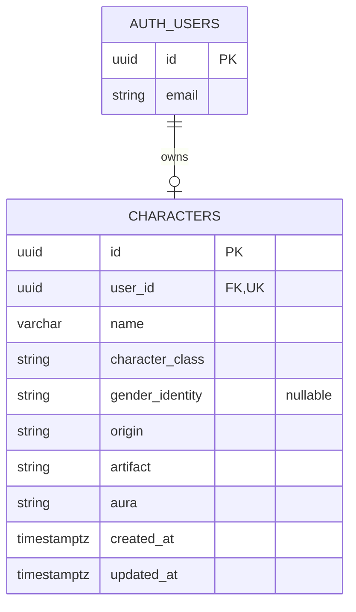

# RPG Character Creator — Data Model

## Entity-Relationship Diagram

## Entities

### AUTH_USERS

Managed by Supabase Auth.

The application does not store user passwords in the
character database table.

### CHARACTERS

Stores the customized character belonging to an authenticated user.

## Relationships

- One user can own zero or one character.
- Every character belongs to exactly one user.
- The `user_id` column is unique.
- `user_id` references `auth.users(id)`.
- Deleting a user should also remove their associated character.

## Data Constraints

- Character names must contain between 2 and 32 characters.
- Character classes must match predefined valid values.
- Gender identity is optional.
- Origin, artifact, and aura must use predefined valid values.
- Database policies must prevent cross-user access.

## Design Notes

The `AUTH_USERS` entity represents the Supabase-managed
`auth.users` table.

Only the `characters` table needs to be created by the application.

The unique constraint on `user_id` enforces the rule of
one character per user.

The interface theme is a local user preference and is not
stored in the character table.

The exact allowed values for origin, artifact, and aura
will be defined before implementing the database schema.