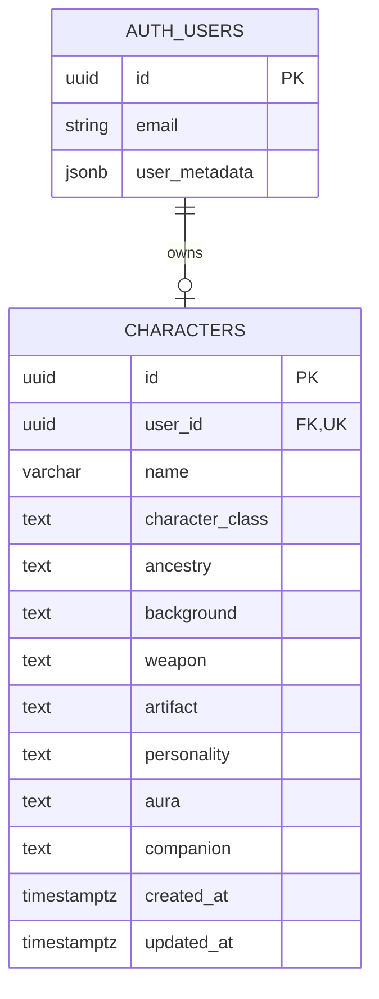

# RPG Character Creator — Data Model

## Entity Relationship Diagram

## Source of Truth

- **AUTH_USERS:** The Supabase-managed `auth.users` identity table. Email, password credentials, confirmation and recovery belong to Supabase Auth. A minimal `display_name` can be maintained in authenticated-user metadata.
- **CHARACTERS:** Application-owned `public.characters` table for fictional character records. It stores a **single** row per user, not account credentials.
- **Relationship:** One user may have zero or one character; every character belongs to one existing user.
- **Ownership:** `user_id` references `auth.users(id)`, is non-null, and has a UNIQUE constraint.
- **Delete behavior:** Use `ON DELETE CASCADE` on the Auth user FK so deleting the account also removes the character.

## Proposed Constraints

| Column | Rule |
|---|---|
| `id` | UUID primary key, server-generated |
| `user_id` | UUID not null, unique, references auth.users |
| `name` | Trimmed fictional character name, 2–32 characters |
| `character_class` | One of the 8 class slugs |
| `ancestry` | One of the 6 ancestry slugs |
| `background` | One of the 6 background slugs |
| `weapon` | One of the 8 weapon slugs |
| `artifact` | One of the 9 artifact slugs, including `none` |
| `personality` | One of the 8 personality slugs |
| `aura` | One of the 8 aura slugs |
| `companion` | One of the 8 companion slugs, including `none` |
| `created_at` | DB-managed timestamp |
| `updated_at` | Updated on successful write |

The [Customization Catalog](../customization-catalog.md) lists all allowed values. Exact SQL constraints and the migration strategy will be implemented alongside the database setup.

## Row Level Security

Enable RLS for `public.characters` and create separate policies:

- SELECT: `auth.uid() = user_id`.
- INSERT: `WITH CHECK (auth.uid() = user_id)`.
- UPDATE: existing owner must match `auth.uid()` and resulting row must remain owned by that same user.
- DELETE: `auth.uid() = user_id`.

The API must run per-user database operations with the caller's verified user identity, not a service-role connection that bypasses RLS. Test user A vs user B at both API and DB levels.

## Privacy and Application Design

- The app collects only display name, email, and authentication information required by Supabase Auth.
- No sex, gender, gender identity, or selectable body type is collected or stored.
- Illustrations are static assets keyed by character class, not persisted image or appearance selections.
- A PDF is generated from the authenticated user's already-loaded fictional character data in the browser, not stored in the database.
- Theme preference is local to the browser and not part of the character record.
- Characters use stable catalog slugs; labels/descriptions can change without changing saved values.
